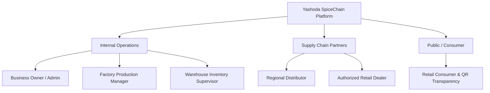

# Yashoda SpiceChain — Comprehensive User Manual
**Milestone:** M11 (Final) | **Task:** T-110  
**Application:** Yashoda Masale Enterprise Resource Planning & AI Assistant Platform  
**Target Audience:** Business Owner, Factory Operators, Warehouse Supervisors, Distributors, Dealers, and Retail Consumers  

---

## 1. System Overview & Role-Based Navigation

Yashoda SpiceChain is an enterprise supply chain, quality traceability, and demand forecasting platform customized for spice manufacturing (Yashoda Masale, Satara, Maharashtra).

The platform enforces strict Role-Based Access Control (RBAC) across six primary personas:

---

## 2. User Role Workflows & Screen Guides

### 2.1 Persona 1: Business Owner / Executive
**Access Scope:** Full system visibility, financial analytics, AI tool runs audit, catalog management, user provisioning, and pricing tier administration.

#### Key Workflows:
1. **Sales & Inventory Analytics:**
   - Navigate to `/analytics/sales` or use AI assistant to request `"Summarize spice sales for the last 30 days"`.
   - Filter sales summaries by `last_7_days`, `last_30_days`, `last_90_days`, or `all_time`.
   - Group analytics by `variant`, `product`, or `category`.
   - Export CSV sales reports for accounting reconciliation.
2. **AI Tool Runs Audit:**
   - Navigate to `/api/v1/ai/audit/tool-runs` to review all AI queries executed across the enterprise.
   - Verify that any denied tool execution attempts (e.g., unauthorized access attempts) are logged with timestamp, user ID, and parameter details.
3. **Price List Administration:**
   - Configure pricing tiers: `MRP` (Consumer), `DEALER` (Retail Shop), and `DISTRIBUTOR` (Bulk Wholesale).
   - Ensure effective dates (`valid_from`) are scheduled for seasonal price adjustments.

---

### 2.2 Persona 2: Factory Production Manager
**Access Scope:** Procurement receipts, raw material quality checks, production batches, quality parameters, and batch release authorization.

#### Key Workflows:
1. **Receiving Raw Spice Shipments:**
   - Navigate to **Procurement > Receipts**.
   - Select the approved supplier (e.g., Guntur Chilli Traders, Sangli Turmeric Mandi).
   - Record lot number, quantity received (kg), moisture content (%), and laboratory test results.
2. **Scheduling a Production Batch:**
   - Navigate to **Production > Batches > New Batch**.
   - Select production plan, target spice variant (e.g., *Special Sunday Mutton Masale 100g*), and planned quantity.
   - Batch status begins in `draft` and advances to `in_production` through stages: Cleaning, Roasting, Grinding, Blending, and Packaging.
3. **Quality Gates & Release (Rule B2):**
   - Perform quality checks against laboratory limits (Moisture <= 10.0%, Total Ash <= 7.0%, Aflatoxin Non-detectable).
   - Submit formal Quality Decision:
     - `released`: Batch immediately creates sellable warehouse inventory balance with unique batch code and expiry date.
     - `on_hold`: Batch quarantined pending secondary inspection.
     - `rejected`: Batch marked unusable; no warehouse stock is generated.

---

### 2.3 Persona 3: Warehouse Inventory Supervisor
**Access Scope:** Warehouse stock balances, FEFO pick lists, order packing, dispatching, and physical stock adjustments.

#### Key Workflows:
1. **Real-Time Stock Monitoring:**
   - View warehouse inventory across central and regional hubs.
   - Inspect balances by batch: `on_hand`, `reserved`, and `available` (`on_hand - reserved`).
2. **Order Picking via FEFO (Rule B3):**
   - When an order is placed, the system automatically allocates stock from the earliest-expiring released batch.
   - Review pick list displaying warehouse bin location, batch number, and expiration date.
3. **Order Packing & Dispatch:**
   - Once picked, advance order status to `packed` (`POST /api/v1/orders/{id}/pack`).
   - When handed over to the carrier, execute dispatch (`POST /api/v1/orders/{id}/dispatch`).
   - The system automatically:
     - Decrements physical `on_hand` and `reserved` balances.
     - Appends an immutable `DISPATCH` entry to the `stock_movements` ledger.
     - Generates an official tax `Invoice` and logistics `Shipment` record with tracking reference.
4. **Physical Stock Adjustments (Rule B4 / B5):**
   - For physical inventory counts or damaged packs, record an adjustment with mandatory audit reason code (`damage`, `cycle_count`, `spillage`).

---

### 2.4 Persona 4: Regional Distributor
**Access Scope:** Wholesale bulk catalog, distributor tier pricing, container-load ordering, repeat reorders, and invoice tracking.

#### Key Workflows:
1. **Wholesale Catalog Browsing:**
   - Browse catalog with automatic price resolution to `DISTRIBUTOR` tier (bulk discount pricing).
2. **Bulk Order Builder:**
   - Build orders by carton/case quantity.
   - Provide client-side `Idempotency-Key` to protect against duplicate submissions during network drops.
3. **Invoice & Shipment Tracking:**
   - Download GST invoices (`GET /api/v1/orders/invoices/{id}`).
   - Track shipment milestones: `manifested -> in_transit -> out_for_delivery -> delivered`.

---

### 2.5 Persona 5: Authorized Retail Dealer
**Access Scope:** Retail dealer store, dealer pricing tier, AI conversational reorder assistant, draft order approval.

#### Key Workflows:
1. **Conversational Reorder via AI Assistant (M8 / T-083):**
   - In the dealer portal chat, type: `"I am running low on 500g Chilli powder and 100g Turmeric. Reorder 20 packets each."`
   - The AI assistant verifies dealer catalog pricing, creates an `OrderDraft` in `draft` status, and presents an itemized preview.
2. **Human-in-the-Loop Order Approval (Rule B11):**
   - Review draft details: variant SKUs, pack sizes, dealer prices, and total estimated cost.
   - Click **Approve Draft** (`POST /api/v1/ai/drafts/{id}/approve`).
   - The system validates that draft transitions atomically into a confirmed `pending` Order, allocating FEFO stock if available.

---

### 2.6 Persona 6: Retail Consumer & Public QR Transparency
**Access Scope:** Retail catalog (MRP pricing), order history, and public product traceability scan.

#### Key Workflows:
1. **Purchasing Spices at Retail:**
   - Order direct from Yashoda Masale e-commerce store with prices resolved to standard `MRP`.
2. **Scanning Packaging QR Code for Farm-to-Fork Traceability (Rule B10):**
   - Scan the on-pack QR code using any smartphone camera.
   - View the public transparency timeline:
     - Spice harvest region (e.g., Malwa Turmeric, Guntur Chilli).
     - Factory processing dates and roasting method.
     - Quality check laboratory sign-off date.
     - *Zero internal commercial data (raw material supplier purchase prices, production margins) is ever exposed.*

---

## 3. Error Handling & Frequently Asked Questions (FAQ)

| Error Code | Meaning | User Action |
| :--- | :--- | :--- |
| `USE_DEDICATED_ENDPOINT` | Direct PATCH `/status` is restricted | Use dedicated buttons: Reserve, Pack, Dispatch, Cancel, Return |
| `INSUFFICIENT_STOCK` | Available stock < requested quantity | Reduce ordered quantity or check upcoming released production batches |
| `IDEMPOTENCY_CONFLICT` | Same idempotency key used with different order payload | Check if previous order succeeded, or generate a fresh order request |
| `ILLEGAL_STATE_TRANSITION` | Transition violates state machine | Follow sequential workflow (`pending -> reserved -> packed -> dispatched -> delivered`) |
| `TOOL_FORBIDDEN` | AI tool requires higher privileges | Only the business owner can access sensitive sales and slow-movers summaries |
